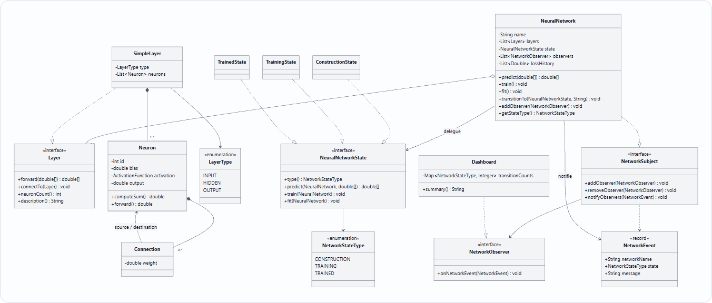
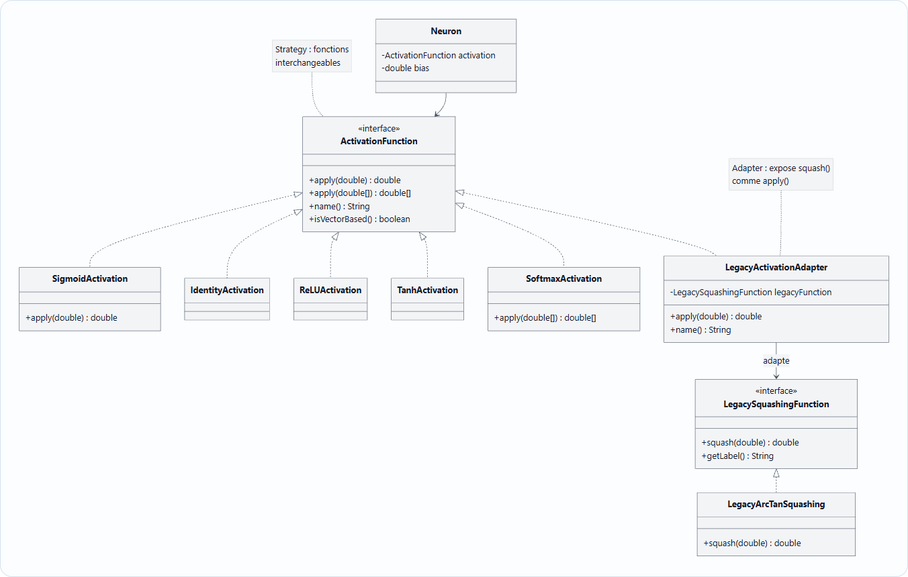
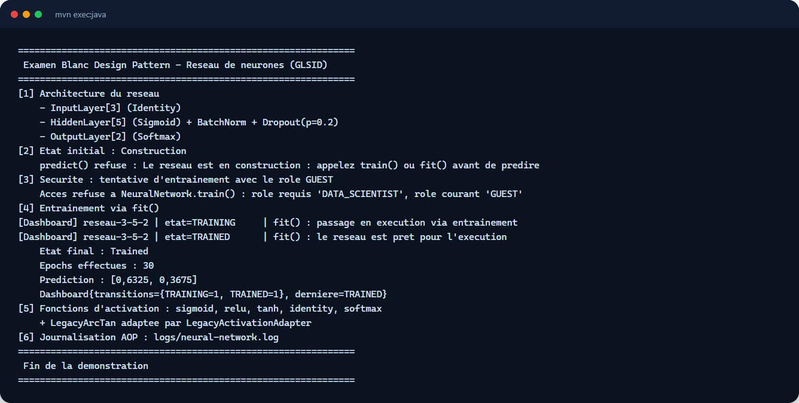

# Examen Blanc Design Pattern — Réseau de neurones artificiels

Implémentation Java (Maven) d'un réseau de neurones entièrement connecté, conçue autour des
design patterns demandés dans l'énoncé de l'examen **Design Pattern (GLSID — ENSET Mohammedia)**.
Le dépôt contient le code source, les tests, les diagrammes de classes et le rapport PDF.

**Encadré par Mr Youssfi** — Réalisé par **Taha Nachit**

**Java 17** · **Maven** · **AspectJ 1.9.27** · **JUnit 5** · **43 tests — 0 échec**

## Design patterns mis en œuvre

| Exigence | Pattern | Rôle dans le projet |
|---|---|---|
| a. Famille de fonctions d'activation interchangeables | **Strategy** | `ActivationFunction` + `Sigmoid`, `ReLU`, `Tanh`, `Identity`, `Softmax` |
| b. Adaptation d'une ancienne fonction d'activation | **Adapter** | `LegacyActivationAdapter` adapte `LegacySquashingFunction` |
| c. États Construction / Training / Trained | **State** | `NeuralNetworkState` + `ConstructionState`, `TrainingState`, `TrainedState` |
| d. Notification des composants dépendants | **Observer** | `NetworkObserver` + `Dashboard` |
| e. Comportement dynamique des couches | **Decorator** | `LayerDecorator`, `DropoutDecorator`, `BatchNormalizationDecorator` |
| f. Journalisation de toutes les méthodes | **Aspect (AOP)** | `LoggingAspect` (AspectJ, tissage à la compilation) |
| g. Sécurisation de l'application | **Aspect (AOP)** | `SecurityAspect` + `@Secured` + `SecurityContext` |
| Améliorations | **Factory, Builder, Singleton** | `LayerFactory`, `ActivationFactory`, `NeuralNetworkBuilder`, `NetworkConfig` |

## Rapport

Le rapport complet (conception, code, tests, captures d'écran) est disponible ici :
**[docs/rapport.pdf](docs/rapport.pdf)** — 15 pages.

Les diagrammes de classes sont dans [`docs/diagrams/`](docs/diagrams) (sources Mermaid) et les
captures dans [`docs/screenshots/`](docs/screenshots).

### Aperçu

| Domaine, State & Observer | Strategy & Adapter |
|---|---|
|  |  |



## Structure du projet

```
src/main/java/ma/enset/nn/
├── Main.java                  # Démonstration exécutable
├── activation/                # Strategy + Adapter
├── aspect/                    # LoggingAspect, SecurityAspect, @Secured, SecurityContext
├── builder/                   # NeuralNetworkBuilder
├── config/                    # NetworkConfig (Singleton)
├── core/                      # NeuralNetwork, Layer, SimpleLayer, Neuron, Connection
├── decorator/                 # LayerDecorator, Dropout, BatchNormalization
├── factory/                   # ActivationFactory, LayerFactory
├── observer/                  # NetworkObserver, NetworkSubject, Dashboard, NetworkEvent
└── state/                     # États du réseau
src/test/java/ma/enset/nn/     # 10 classes de tests (43 tests JUnit 5)
docs/                          # sujet, rapport PDF/HTML, diagrammes, captures
```

## Compilation, tests et exécution

```bash
mvn clean test          # compile, tisse les aspects et exécute les 43 tests
mvn exec:java           # lance la démonstration (réseau 3-5-2, états, sécurité, AOP)
```

## Auteur

**Taha Nachit** — GLSID, ENSET Mohammedia (Université Hassan II de Casablanca).
